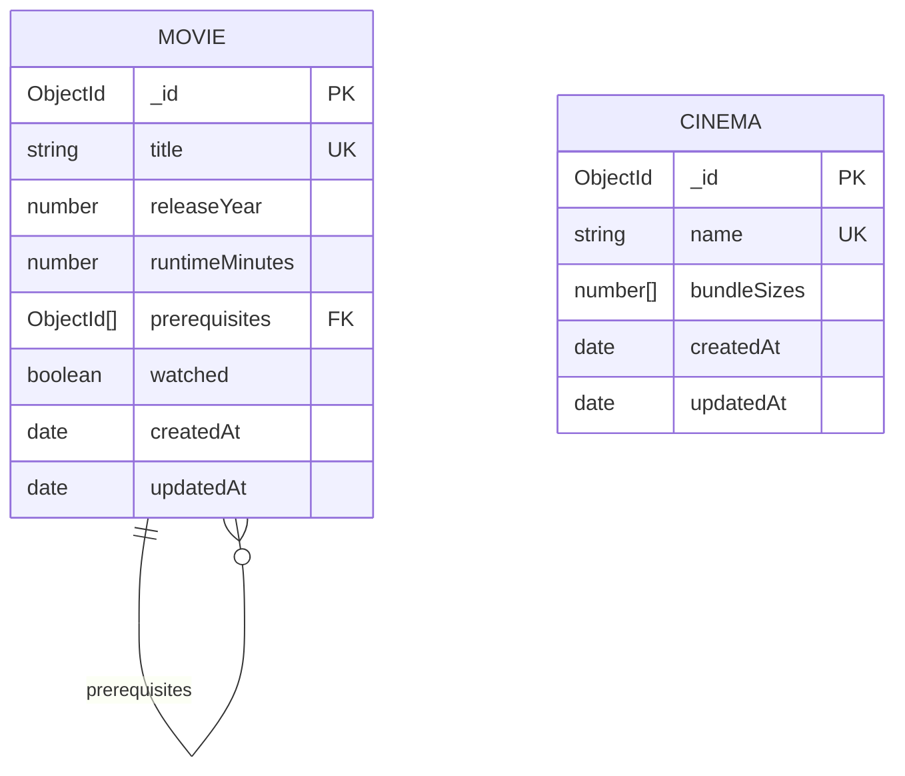

# Doomsday Ready

A full-stack MCU rewatch planner and opening-night watch-party booking app built with **React + TypeScript + Tailwind CSS (shadcn-style UI)**, **Express + TypeScript**, and **MongoDB**.

## Features

1. **Movies & Rewatch Order**
   - Create and update movies (`title`, `releaseYear`, `runtimeMinutes` 1–300, `prerequisites`, `watched`).
   - Direct and transitive circular dependency detection returning `409 CIRCULAR_DEPENDENCY`.
   - Topological rewatch order (`GET /api/movies/:id/rewatch-order`) using post-order DFS: returns all prerequisites in watch order (excluding the target movie), watched count, and remaining unwatched runtime.
2. **Cinemas & Watch-Party Booking**
   - Create cinemas with 1–10 unique seat bundle sizes (1–500 seats each).
   - Minimum bundle quote (`GET /api/cinemas/:id/booking?groupSize=N`) using dynamic programming to find the fewest bundles summing to `groupSize` (1–10,000), or `"Not possible"` when no exact combination exists.
3. **Frontend (3 Views)**
   - **Movies**: Add movies, load sample MCU data, edit prerequisites, and tick movies as watched.
   - **Rewatch Plan**: Pick a target movie to see the ordered rewatch list, progress bar, and remaining watch time.
   - **Booking**: Create cinemas, pick a cinema, enter a group size, and view the optimal bundle breakdown.

## Data Model Diagram



## API Reference

All endpoints are mounted under `/api`:

| Method & Path | Purpose |
| --- | --- |
| `POST /api/movies` | Create a movie |
| `GET /api/movies` | List all movies |
| `PATCH /api/movies/:id` | Update a movie (including `watched` and `prerequisites`) |
| `GET /api/movies/:id/rewatch-order` | Compute topological rewatch order & watch stats |
| `POST /api/cinemas` | Create a cinema |
| `GET /api/cinemas` | List all cinemas |
| `GET /api/cinemas/:id/booking?groupSize=6` | Compute minimum seat bundles for `groupSize` |

## Running the App

### Option 1: Docker Compose (Recommended)

```bash
docker compose up --build
```

- Frontend: `http://localhost:3000`
- Backend API: `http://localhost:5000/api`
- MongoDB: `mongodb://localhost:27017`

### Option 2: Local Development

**Backend** (requires MongoDB running locally):
```bash
cd backend
npm install
npm run dev
```

**Frontend**:
```bash
cd frontend
npm install
npm run dev
```

Open `http://localhost:5173`.

## Testing Core Logic

```bash
cd backend
npx tsx tests/logic.test.ts
```

## Reasonable Choices & Assumptions

- **Authentication**: Not included, as the specification has no user accounts or login requirements.
- **Booking Quote Response**: When no exact bundle combination exists, `GET /api/cinemas/:id/booking` returns `200 OK` with `{ possible: false, message: "Not possible" }` so the frontend can display the result cleanly.
- **Uniqueness**: Duplicate movie titles or cinema names are rejected with `409 Conflict` / `400` via MongoDB unique indexes.

## AI Tool Usage

An AI coding assistant was used to scaffold the backend Express/Mongoose modules, implement the React + Tailwind/shadcn frontend components, set up Docker Compose, and verify the topological sort and dynamic programming algorithms with automated tests.
